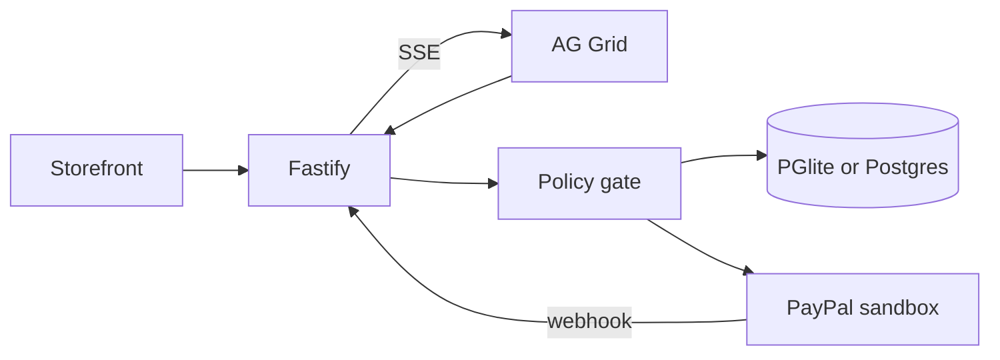

# Architecture

One Node process. Fastify serves the API, the server-sent event stream, and the built React app. Agents run in that process because the Render free tier has no worker.

Proposal states: `proposed` to `auto_approved` or `pending_approval` or `blocked`, then `approved`, `executing`, `submitted`, `confirmed`. Side paths: `rejected`, `superseded`, `failed`, `rolled_back`, `rollback_failed`.

Idempotency: `actions.idempotency_key` is unique, payout `sender_batch_id` is the proposal id, and REST posts send `PayPal-Request-Id`. The toolkit refund path does not document that header, so a failed toolkit call falls back to the REST refund with the same key.

Live updates: `GET /api/events`. Grids call `applyTransactionAsync`.
